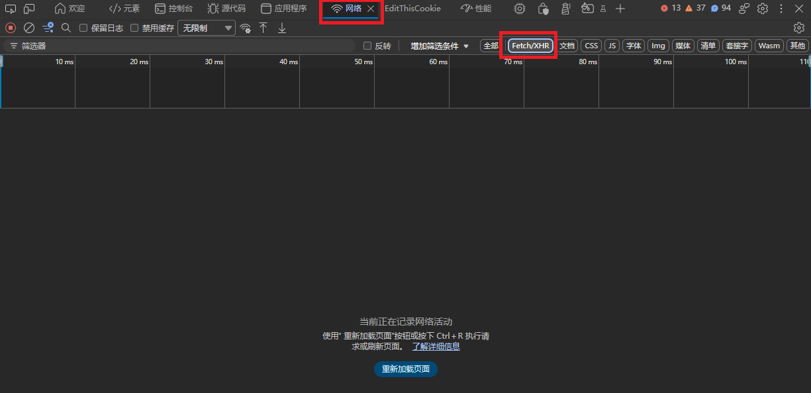
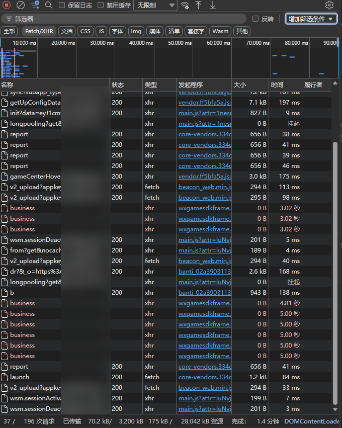
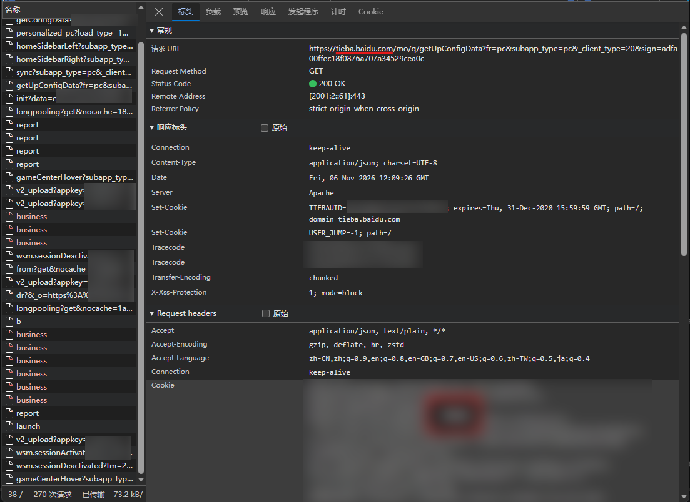
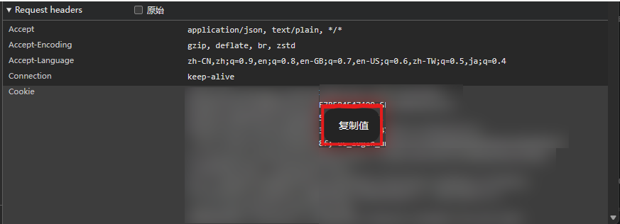

# 如何获取百度贴吧的 Cookie 数据

在浏览器内获取贴吧 Cookie 数据并登录到贴吧桌面内十分简单。以下教程以 Edge 浏览器为例。

## 操作方法

1) 在你的浏览器里登录贴吧账号
2) 打开 `tieba.baidu.com` 下的任意一个网页
3) 按 F12 打开开发者工具，切换到 `网络` 选项卡，并设置请求筛选器类型为 `Fetch/XHR`  
   
4) 按 `Ctrl+R` 或者点中间的按键刷新网页，此时会抓取到大量贴吧的 HTTP 请求  
   
5) 找一个请求 URL 域名是 `tieba.baidu.com` 的请求，如下图
   
6) 找到下方的 `Request Headers`， `Cookie` 这栏的字段即为我们想要的 Cookie 数据
   
7) 右键点击`复制值`，把 Cookie 数据复制进贴吧桌面的 Cookie 登录窗口内即可
